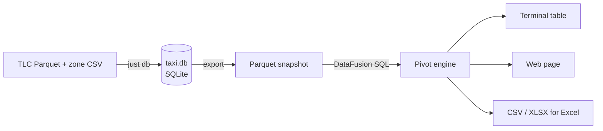
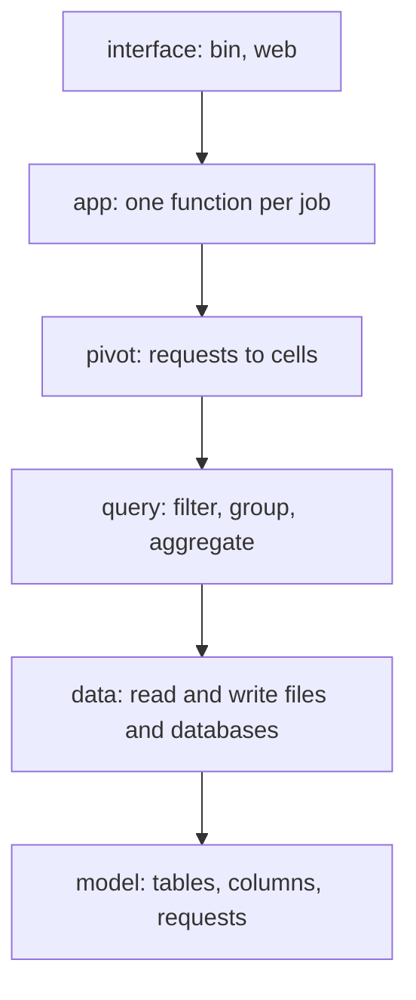

# High-level design

Goal: a viewer runs an Excel-style pivot (rows × columns × value) over a month of NYC taxi trips, in Rust, and gets the answer in under a second. Baseline: the same pivot takes about 4.5 s in plain SQLite.

## Where we start

Real reports start from data in a normal database, so we start there too. `just db` turns the public TLC files into `data/taxi.db` (SQLite):

| Table | Rows (Jan 2024) | Columns |
|---|---|---|
| `trips` | 2,964,624 | vendor, pickup and dropoff time, passengers, distance, rate code, pickup and dropoff zone, payment type, fare, tip, total |
| `zones` | 265 | zone id, borough, zone, service zone |

Times are New York local time, stored as text `YYYY-MM-DD HH:MM:SS`. Money is `REAL`, as in the source file; exact money is a later episode. Rows are kept as published, including odd ones: cleaning is a visible decision, not a silent one.

## Where we go

1. **Source**: SQLite holds the trips, like an application database.
2. **Snapshot**: export to Parquet, column by column, once per refresh.
3. **Query**: DataFusion reads only the columns a pivot needs.
4. **Pivot**: a request (rows, columns, value, aggregate) becomes grouped cells with headers and totals.
5. **Show**: terminal first, then a web page, then a file for Excel.

Each arrow is one or more episodes. We build only the arrow the next scenario needs.

## Layers

Calls only go down. Rules and limits: `AGENTS.md` ("Stratified design", "Code shape").

Today only `app`, `data` and `model` exist. The others come when a scenario needs them.

## How we build it

- BDD outside: every feature starts as a scenario in `features/*.feature`.
- TDD inside: Red → Green → Refactor for every function.
- Every number said on camera is measured on the author's machine and written down with the command.

## Open questions

- SQLite → Parquet: write our own export, or a DataFusion SQLite table provider? Test both before choosing.
- How big may a pivot get (rows × columns) before the terminal table stops being useful?
